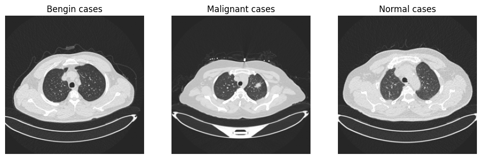
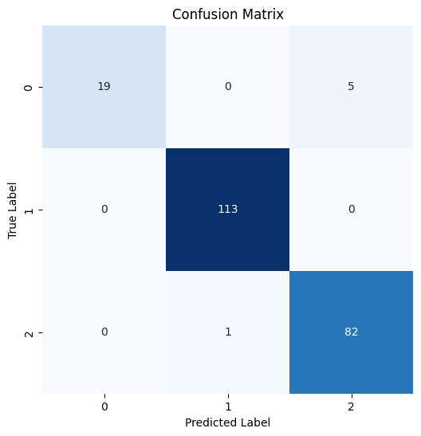

<div align="center">

# DenseNet169 with Attention and Multi-Scale Fusion for Lung Cancer CT Classification

**Experimental notebook from the research behind *A Hybrid Deep Learning Framework with Explainable AI for Lung Cancer Classification with DenseNet169 and SVM*.**

[](https://arxiv.org/abs/2512.03359)
[](#publication)
[](https://www.tensorflow.org/)
[](LICENSE)

</div>

> [!IMPORTANT]
> This is research code, not a diagnostic tool. It must not be used for clinical decisions.

## Publication

**A Hybrid Deep Learning Framework with Explainable AI for Lung Cancer Classification with DenseNet169 and SVM**
Md Rashidul Islam, Bakary Gibba, Altagi Abdallah Bakheit Abdelgadir
Under review at the *IAES International Journal of Artificial Intelligence*. Preprint: [arXiv:2512.03359](https://arxiv.org/abs/2512.03359)

### How this repository relates to the paper

The paper's final pipeline is a **DenseNet169 + SVM hybrid** interpreted with **Grad-CAM and SHAP**. This repository contains a related experiment from the same work: an end-to-end DenseNet169 classifier extended with channel attention, multi-scale feature fusion and focal loss. The SVM stage and the XAI analysis are **not** included here; see the preprint for those.

## Dataset

[IQ-OTH/NCCD lung cancer dataset](https://www.kaggle.com/datasets/hamdallak/the-iqothnccd-lung-cancer-dataset): chest CT slices in three classes (benign, malignant, normal). The dataset is not redistributed here.



## Method

| Component | Details |
| --- | --- |
| Backbone | DenseNet169 without the top classifier, initialised from ImageNet weights |
| Attention | Squeeze-and-Excitation block (ratio 16) on the backbone output |
| Multi-scale fusion | FPN-style fusion of the four dense-block outputs |
| Loss | Class-weighted focal loss (γ = 2, α = [10, 1, 2]) |
| Imbalance | SMOTE applied to the training split only |
| Input | 256 × 256 greyscale slices replicated to three channels |
| Training | Adam, batch size 32, 20 epochs, `ReduceLROnPlateau` on validation loss |
| Split | Stratified 80/20 train/test (`random_state=42`) |

## Results

Test set: 220 CT slices (stratified 20% split).

| Class | Precision | Recall | F1 | Support |
| --- | ---: | ---: | ---: | ---: |
| Benign | 1.00 | 0.79 | 0.88 | 24 |
| Malignant | 0.99 | 1.00 | 1.00 | 113 |
| Normal | 0.94 | 0.99 | 0.96 | 83 |
| **Accuracy** | | | **0.97** | 220 |
| Macro average | 0.98 | 0.93 | 0.95 | 220 |



Labels: 0 = benign, 1 = malignant, 2 = normal. Benign is the hardest class: 5 of 24 benign slices were predicted as normal.

### Notes on evaluation

- The test split is also passed to `model.fit` as `validation_data`, so the learning-rate schedule responds to test-set loss. A separate validation split would give a cleaner estimate.
- The split is at slice level. If one patient contributes several slices, related slices can appear in both training and test sets.
- Results come from a single split of one public dataset, with no external validation.

## Repository Contents

| File | Purpose |
| --- | --- |
| [`densenet169-se-fpn-lung-ct.ipynb`](densenet169-se-fpn-lung-ct.ipynb) | Data loading, SMOTE, model, training and evaluation (Kaggle notebook) |
| [`figures/`](figures/) | Sample slices and confusion matrix exported from the notebook |
| [`CITATION.cff`](CITATION.cff) | Citation metadata for the preprint |

## Reproducing

The notebook was run on Kaggle with the IQ-OTH/NCCD dataset and DenseNet169 ImageNet weights attached as Kaggle inputs. To run it elsewhere, update `DATASET_PATH` and `densenet169_weights_path` in the notebook.

## Citation

```bibtex
@misc{islam2025hybrid,
  author = {Md Rashidul Islam and Bakary Gibba and Altagi Abdallah Bakheit Abdelgadir},
  title = {A Hybrid Deep Learning Framework with Explainable AI for Lung Cancer Classification with DenseNet169 and SVM},
  year = {2025},
  eprint = {2512.03359},
  archivePrefix = {arXiv}
}
```

---

<div align="center">

**Part of [Bakary Gibba's AI engineering portfolio](https://github.com/BakaryGibba/bakary-gibba-ai-engineering-portfolio)**

[Portfolio website](https://bakary-gibba.vercel.app/) · [LinkedIn](https://www.linkedin.com/in/bakary-gibba-6409bb248/) · [Google Scholar](https://scholar.google.com/citations?user=bp0G4sgAAAAJ&hl=en)

</div>
